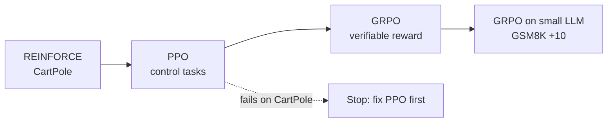

# reinforcement-learning-challenges

Reinforcement learning from scratch, from policy gradients up to RL on a language model.

Goal: implement PPO and GRPO from scratch, then train a small LLM with GRPO on a verifiable reward to gain 10+ points on GSM8K.

## Path

1. Policy gradients (REINFORCE) solving CartPole
2. PPO from scratch on standard control tasks
3. GRPO from scratch on a verifiable reward
4. GRPO run on a small LLM, scored on GSM8K

Rule: if PPO does not solve CartPole reliably, GRPO waits.
